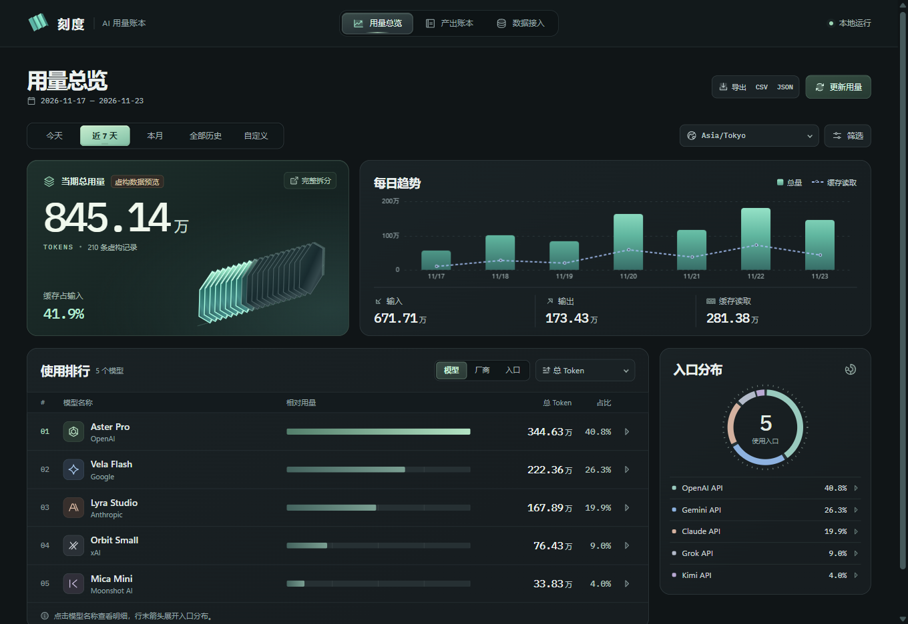

# 刻度 · AI 用量账本

在 Windows 本机核对不同厂商、入口和模型的实际 Token 用量。选好日期和统计时区，就能从每日趋势和模型排行一路查到原始用量记录。项目、费用、额度和产出也可以留在本机。

## Windows x64 下载

- **[下载原版便携包（ZIP）](https://github.com/guofudamo2007-lab/ai-usage-ledger/releases/download/v1.7-preview/Meter-1.7-preview-Windows-x64.zip)** · **1.7-preview**　想用视频同款，或继续使用已有账本，选原版。完整解压到可写目录，双击 `启动账本.cmd`。[使用与升级说明](使用说明.md)
- **[下载 Rust 单文件版（EXE）](https://github.com/guofudamo2007-lab/ai-usage-ledger/releases/download/rust-v0.2.0-preview/Kedu-Rust-Windows-x64.exe)** · **0.2.0-preview**　想只下载一个文件、双击就用，选 Rust 版。把 EXE 放进可写目录即可，无需安装 Rust 或 Python，也带桌面小组件。[Rust 版使用说明](native/README.md)

**两版可以同时运行，账本各自独立。** 原版默认使用 `private/`，Rust 版使用 EXE 旁的 `rust-private/`。想把旧账带过来，先停止原版服务，再到 Rust 版「数据接入 → 导入原版账本」选择 `private/ledger.sqlite3`。历史用量、手工账目和自定义单价都会按记录核对；源文件只读，重复导入会去重。[导入步骤](native/README.md#带入原版账本)



预览使用独立的虚构账本。可以看日期选中、趋势悬停、排序和模型明细的实际操作。[交互录屏](docs/interaction-fictional.webp) · [窄窗口全图](docs/narrow-fictional.png)

**1.7-preview** 支持等效 API 价值、自定义模型单价、来源健康诊断、导入预检与批次撤销、项目归并和逐条更正。[稳定版下载](https://github.com/guofudamo2007-lab/ai-usage-ledger/releases/latest) · [升级与核对说明](使用说明.md#核对与更正)

## 能看什么

- **桌面小组件**　双击便携包里的 `MeterWidget.exe`，或点主界面右上角「小组件」。窗口可拖动、置顶，查看今天或近 7 天的用量，也可翻到订阅额度快照。
- **外观**　可选深色、浅色或跟随系统。三个主题都能单独调整强调色、背景色、文字色和界面字体。保存后主界面和小组件共用同一份设置。
- **用量和排行**　支持今天、近 7 天、本月、全部历史和自定义日期。按模型、厂商或入口分组，可按总量、等效 API 价值、输出或剔除缓存读取后的用量排序。
- **等效 API 价值**　总量卡与桌面小组件按各厂商公开 API 标价估算等效美元金额（含缓存命中省费明细），仅作价值参考；支持按模型自定义或恢复内置单价。
- 总量下有一句随用量变化的比喻，从游戏建言到《四库全书》，刷新时随机轮换。
- **模型明细**　查看同一模型在不同入口和项目中的分布，再按项目、入口或来源筛选逐条记录。CSV 和 JSON 导出覆盖当前条件下的所有分页。
- **产出账本**　按批次登记图像、视频、音频的可用数、重试、修整时间与实付金额。订阅、API 费用和剩余额度各自记账。
- **订阅剩余额度**　在「产出账本 → 剩余额度」自动读取可用的 Codex、GitHub Copilot、Grok、MiniMax 来源，支持导入 Claude 和 Kimi Code 的额度快照。其他对话、编程与创作订阅可从官方入口核对并按原单位记账。Codex 查询方式参考 [Codex Cockpit](https://github.com/HouSiyuan2001/codex-cockpit)。
- **Antigravity 订阅额度**　同一页自动读取本机已登录 AGY CLI 的模型分组、各周期的剩余百分比和重置时间。

## 数据接入

| 接入方式 | 入口 |
| --- | --- |
| 本机只读采集 | Google Antigravity、Antigravity CLI、Antigravity IDE、OpenAI Codex。各入口分别显示可读范围和最近更新时间。 |
| 逐请求文件导入 | OpenAI API、Gemini API、Claude API 支持厂商响应包装或标准明细。Google AI Studio 需要能够确认入口归属的请求记录。Grok API、Kimi API 支持标准 JSON 或 CSV。 |
| 手工记账 | ChatGPT、Gemini、Claude、Grok、Kimi 网页可记费用、额度或产出。 |
| 仅供外部对账 | Obsidian Prism 汇总、按日合计报表、普通聊天导出。 |

输入包含可确认的缓存读写，输出包含可确认的推理。缺失字段显示为「—」，部分覆盖会列出已知条数。相同请求的重复导入可以补全缺失字段。剔除缓存读取的排行只使用总量与缓存读取均已知的记录。[字段口径与虚构格式示例](使用说明.md#计数与去重)

服务绑定本机回环地址。SQLite 账本保存统计字段、项目标签、采集进度、去重标识和手工账目。备份时，先关闭对应版本的本地服务，再复制它的整个数据目录（原版 `private/`，Rust 版 `rust-private/`）。[原版备份与迁移说明](使用说明.md#保存备份与迁移)

## 从源码运行原版

在装有 **Windows x64 CPython 3.14** 的机器上，从仓库根目录执行。前端资源已随源码提供。

```powershell
py -3.14 -m venv .venv
.\.venv\Scripts\python.exe -m pip install --no-cache-dir tzdata==2026.6
.\.venv\Scripts\python.exe -B -X utf8 ledger_app.py
```

使用 `--no-sync` 可以关闭启动和定时采集。测试会在项目目录中创建独立的临时数据库，使用虚构记录。

```powershell
.\.venv\Scripts\python.exe -B -X utf8 -m unittest discover -s tests -v
node --test tests/references.test.mjs
.\.venv\Scripts\python.exe -B -X utf8 tools\package.py --runtime --archive
```

生成的便携包位于 `release/Meter-1.7-preview-Windows-x64.zip`。本版使用 CPython 3.14.6 x64 和 tzdata 2026.6 构建。打包时会用 Windows 的 .NET Framework 4.x 编译器和 WPF 程序集生成 `MeterWidget.exe`。

参照的单位容量已随前端提供。开发时可用装有 `tiktoken==0.12.0` 的 Python 执行 `python tools/build_references.py --check` 复算微量样本与三部固定版本的作品。首次复算会下载校准材料到项目的 `.qa` 目录。[校准脚本](tools/build_references.py)

## 许可证

刻度自身代码使用 MIT 许可证。前端组件和 IBM Plex Mono 字体分别保留上游许可证。Windows 发行包内的 CPython 及所带组件条款见 `runtime/LICENSE.txt`，时区数据条款在 `runtime/tzdata-licenses/`。[MIT](LICENSE) · [前端组件与设计来源](web/vendor/NOTICES.md) · [IBM Plex Mono 许可证](web/fonts/OFL.txt)
